# <p align="center">Define Pretty（翻译翻译，什么叫好看）</p>

<p align="center">简体中文 · <a href="README.en.md">English</a></p>

<p align="center"><strong>把你喜欢的设计点，做成可选项。</strong></p>

<p align="center">
上传一张你喜欢的 UI 截图，让 Codex 提炼其中的配色、字体、布局等等。<br>
勾选你想借鉴的部分，把整理好的规范图片与指令交给 Codex，让它高精度地还原参考图的视觉特征。
</p>

<p align="center">
<a href="#效果展示">效果展示</a> · <a href="#快速开始">快速开始</a> · <a href="#操作指引">操作指引</a> · <a href="#常见问题">常见问题</a>
</p>

## 效果展示

<table>
  <thead>
    <tr>
      <th width="33%">原始网页</th>
      <th width="33%">UI 规范</th>
      <th width="33%">优化效果</th>
    </tr>
  </thead>
  <tbody>
    <tr>
      <td valign="top"><a href="docs/images/showcase/blog/original.jpg"></a></td>
      <td valign="top"><a href="docs/images/showcase/blog/01-feature.png">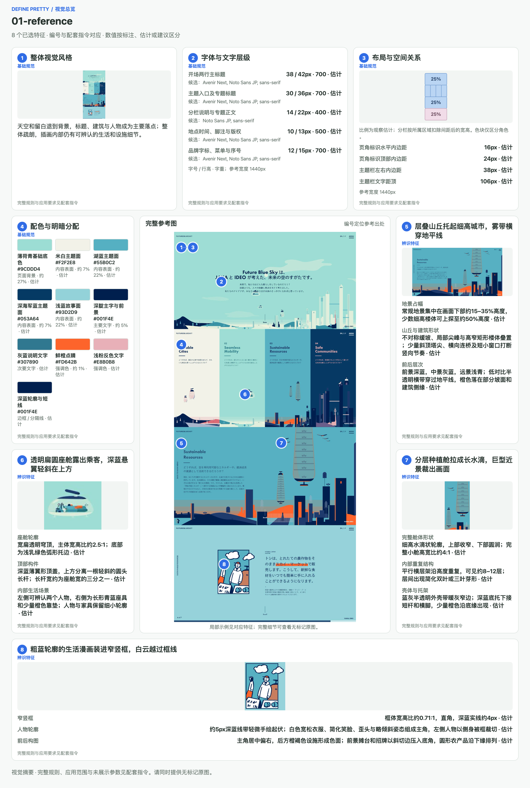</a></td>
      <td valign="top"><a href="docs/images/showcase/blog/01-preview.png">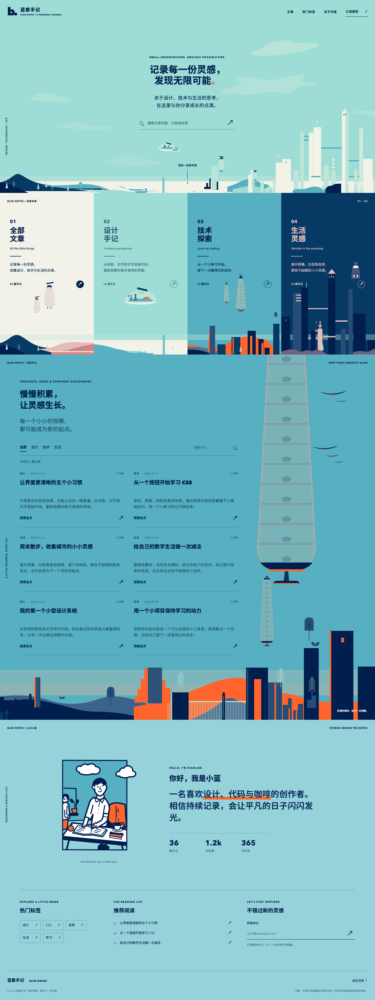</a></td>
    </tr>
    <tr>
      <td valign="top"><a href="docs/images/showcase/blog/original.jpg"></a></td>
      <td valign="top"><a href="docs/images/showcase/blog/02-feature.png">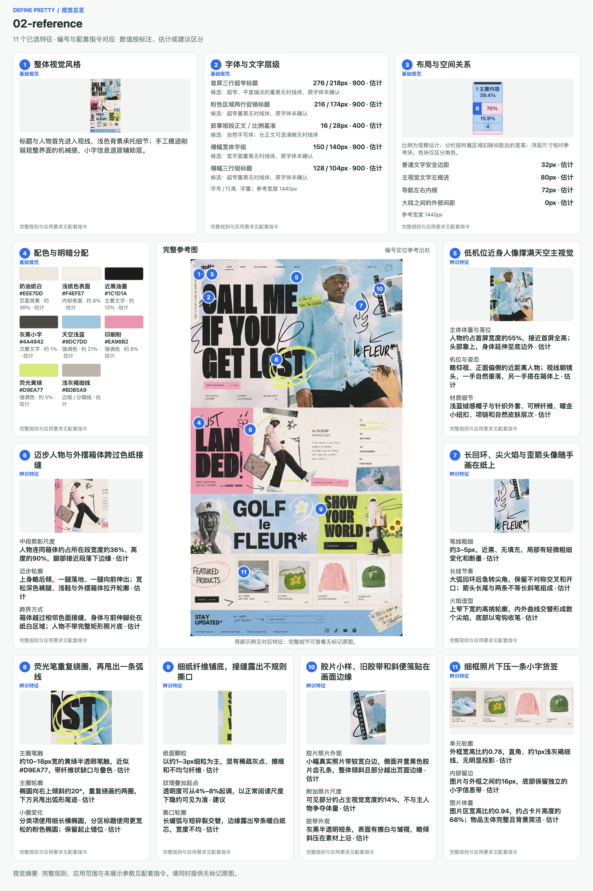</a></td>
      <td valign="top"><a href="docs/images/showcase/blog/02-preview.jpg"></a></td>
    </tr>
    <tr>
      <td valign="top"><a href="docs/images/showcase/dashboard/original.jpg">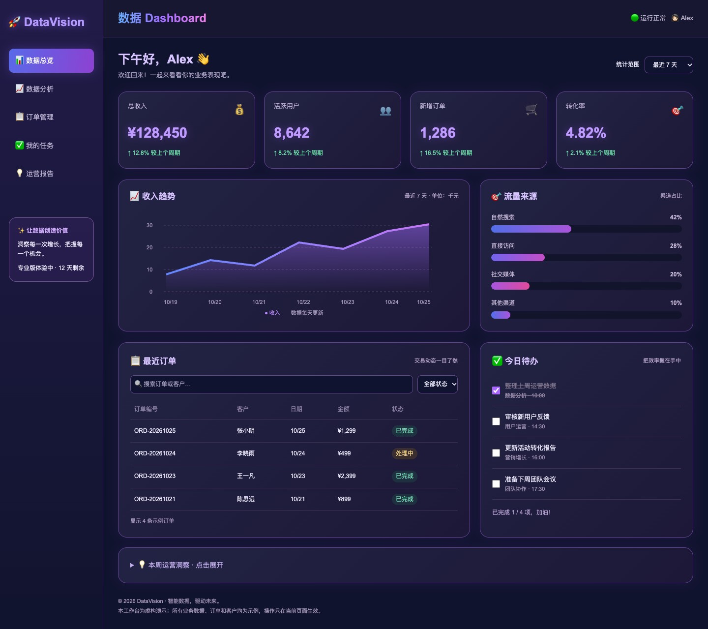</a></td>
      <td valign="top"><a href="docs/images/showcase/dashboard/01-feature.png">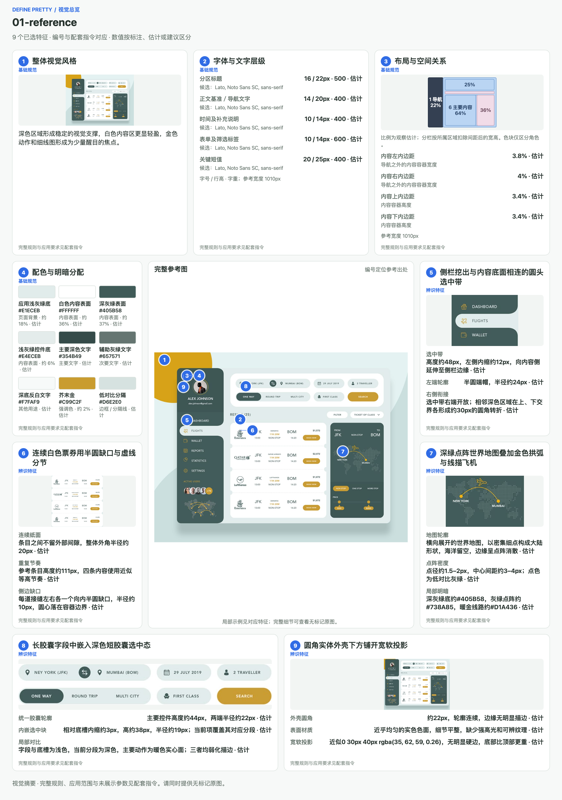</a></td>
      <td valign="top"><a href="docs/images/showcase/dashboard/01-preview.jpg">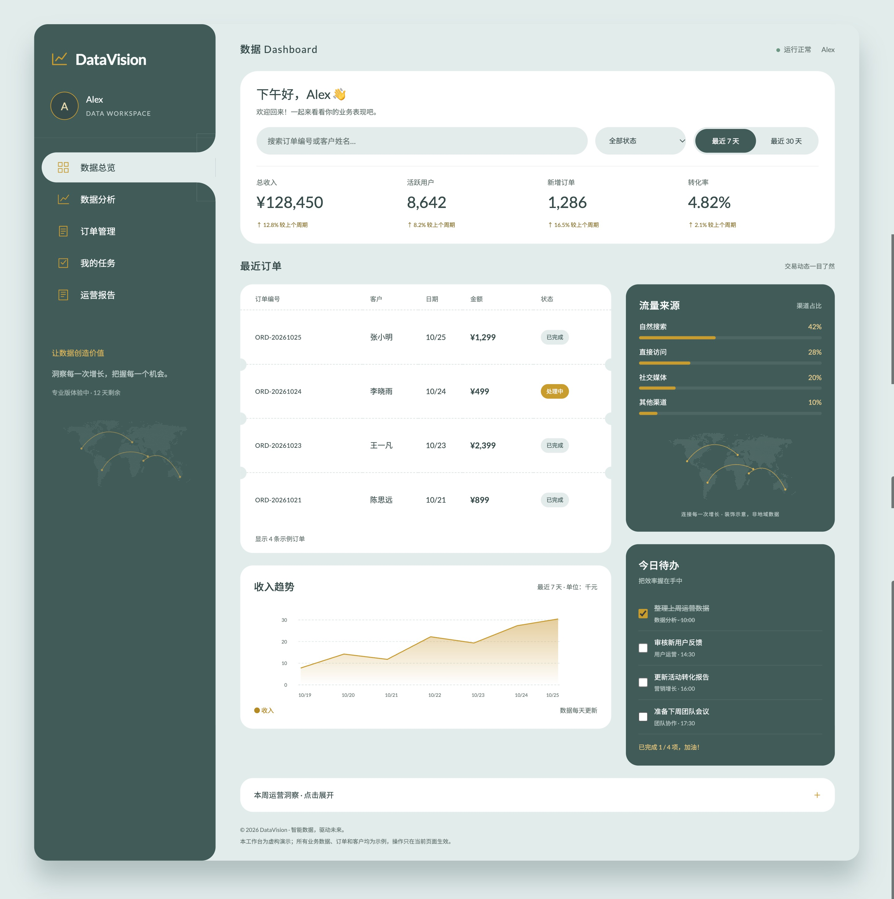</a></td>
    </tr>
    <tr>
      <td valign="top"><a href="docs/images/showcase/resume/original.jpg">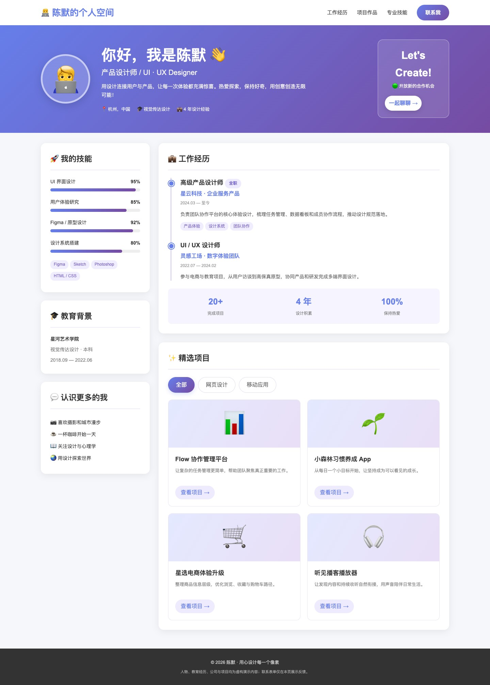</a></td>
      <td valign="top"><a href="docs/images/showcase/resume/01-feature.png">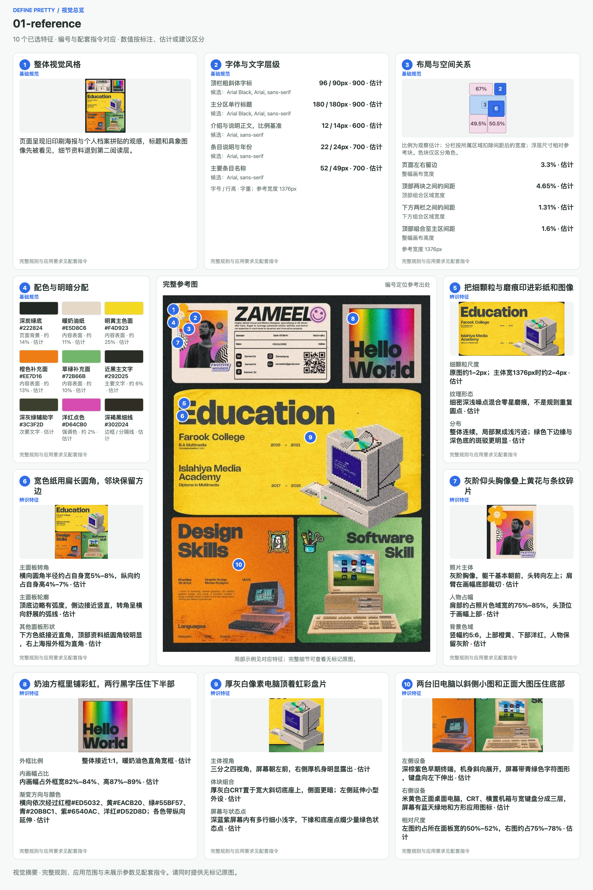</a></td>
      <td valign="top"><a href="docs/images/showcase/resume/01-preview.jpg">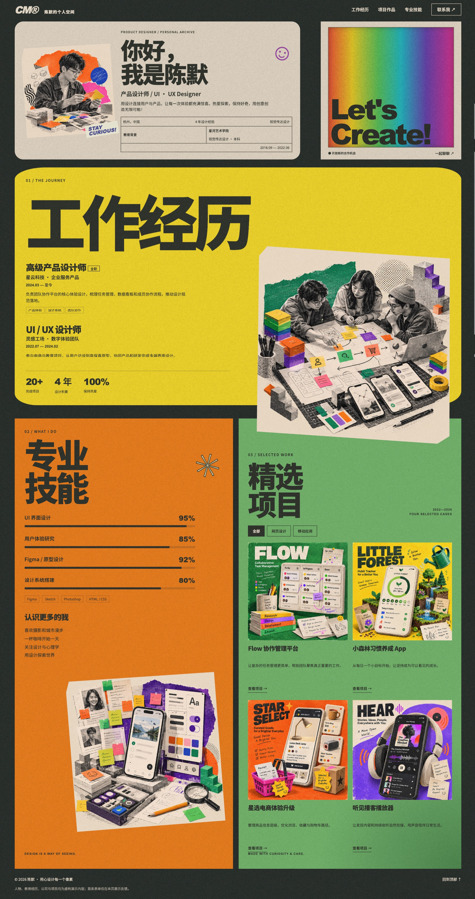</a></td>
    </tr>
  </tbody>
</table>

你可以只借鉴配色和字体，也可以选中布局、材质或装饰方式，再为每一项写下应用范围。实际生成效果会随参考图、所选特征和模型而变化。

### 查看工作台与导出示例

**应用首页**

[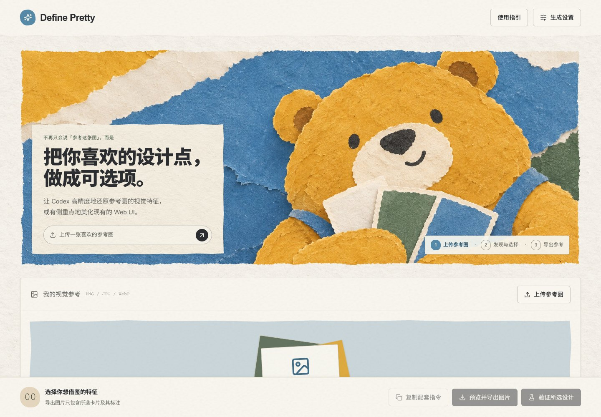](docs/images/app-home.jpg)

**选择设计特征**

参考图放在中间，设计特征围绕它展开。颜色有色板、布局有比例示意、细节有局部示例，可以直接勾选。

[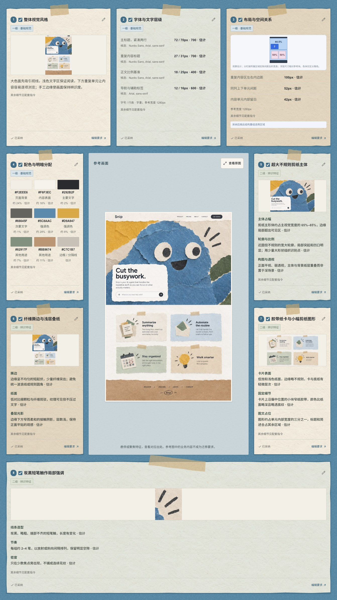](docs/images/feature-overview.jpg)

**导出的视觉总览**

只包含已选特征，可与无标记原图、配套指令一起交给 AI。

[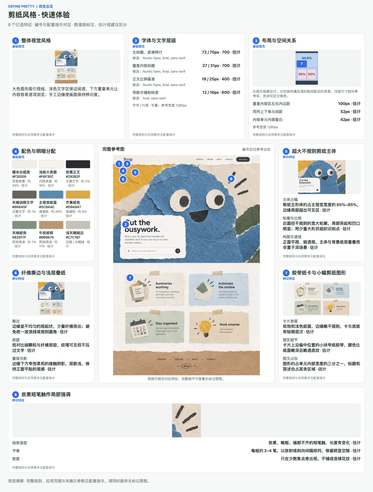](docs/images/selected-features.png)

## 快速开始

### 1. 启动工作台

先安装 **[Node.js](https://nodejs.org/) 22.12 或更新版本**，其中已包含 npm 和 npx。

从本仓库的 **[Releases](https://github.com/SpaceCoder-Kafka/define-pretty/releases)** 下载 `define-pretty.tgz`，在下载目录打开终端，执行：

```sh
npx --yes --package ./define-pretty.tgz define-pretty
```

浏览器会自动打开工作台。保持终端运行；使用结束后按 **Ctrl+C** 退出。若浏览器没有自动打开，访问终端显示的地址即可。

<details>
<summary>尚未下载发布包？也可以从源码启动</summary>

下载或克隆本仓库，在项目目录执行：

```sh
npm ci
npm run dev
```

然后打开终端显示的工作台地址，默认是 `http://127.0.0.1:4193/`。

</details>

### 2. 先体验一次

首次打开会自动进入使用指引，带你走过参考图、特征选择、网页对比和导出。**无需上传图片，也无需安装或登录 Codex**，即可体验这组内置示例。

随时可以跳过；之后点击页头的「使用指引」重新体验。

### 3. 开始使用自己的参考图

真实提炼、AI 补全和网页生成需要本机已安装并登录 **[Codex CLI](https://developers.openai.com/codex/cli/)**。安装后在终端运行：

```sh
codex login
```

完成后重新启动 Define Pretty。它会沿用本机 Codex 的登录与配置。

网页截图和验证会使用电脑上的 Chrome、Edge 或 Chromium。若提示没有可用浏览器，可执行：

```sh
npx --yes --package ./define-pretty.tgz define-pretty --install-browser
```

## 操作指引

### 1. 放入一张喜欢的参考图

点击「上传参考图」，或把图片拖入上传区域。支持 **PNG、JPG、WebP**，最大 **10 MB**。

尽量选择内容清晰、能看出文字层级与页面结构的截图。第一次可以直接使用一张完整页面截图。

[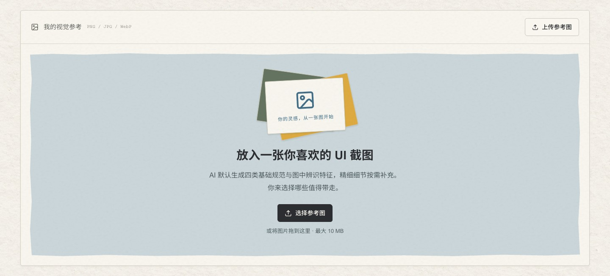](docs/images/guide/01-upload.jpg)

### 2. 提炼设计，勾选喜欢的部分

点击「提炼基础与辨识特征」，等待生成设计卡片。

| 卡片类型 | 可以看到什么 |
| --- | --- |
| 基础规范 | 整体视觉风格、字体与文字层级、布局与空间关系、配色与明暗分配 |
| 辨识特征 | 这张图中特别有辨识度的设计，例如撕纸边缘、硬边框、偏移阴影或插画方式 |
| 精细细节 | 点击「发现更多细节」后补充的细节，按需选择 |

首次生成的完整卡片默认选中，取消不想采用的即可；后续发现的新细节默认不选。鼠标移到卡片上可以查看它在参考图中的位置，也可以点击「查看原图」放大观察。

[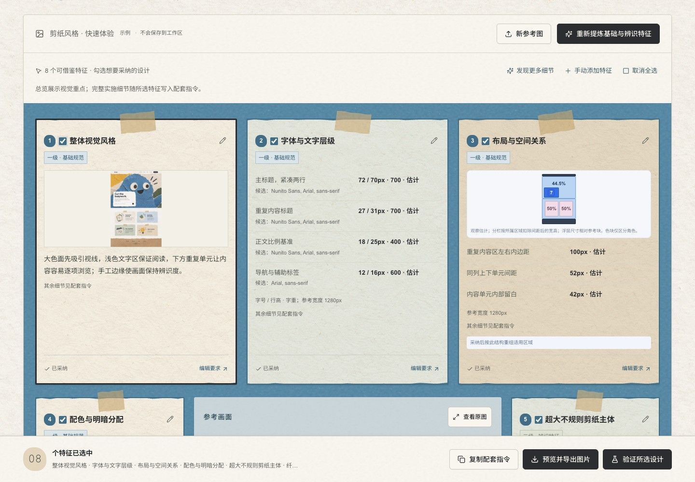](docs/images/guide/02-select.jpg)

### 3. 在网页上验证效果

在下方「原始网页」旁点击「更换网页」，选择一个场景，再点「使用此页」。内置 **8 款网页**，可以直接开始：数据 Dashboard、个人简历、个人博客、SaaS 产品官网、设计师作品集、电商商品页、在线课程和活动报名。

也可以展开「自定义原始网页」，写下需求，让 AI 先生成一个测试起点。

点击「验证所选设计」，完成后左右对比原网页与优化结果，并可全屏查看。还想调整时，写下具体反馈，再点「继续优化此结果」，例如：

> 保留现在的纸张质感，把主标题缩小一些，让首屏露出第一排文章。

每一轮优化都会保留独立记录。继续优化沿用该轮的参考图与所选特征；如果重新勾选了卡片，请再次点击「验证所选设计」。

[](docs/images/guide/03-validate.jpg)

### 4. 带回自己的项目

你也可以直接点击底部「预览并导出图片」，带走这三样内容：

1. **总览 PNG**：你选中的设计特征与关键参数。
2. **无标记原图**：完整参考图，便于 AI 观察风格细节。
3. **配套指令**：所选特征的完整要求，以及你填写的应用范围。

把**两张图片与配套指令一起交给 AI**，再补充你的项目目标即可，例如：

> 请按配套指令，把我选中的设计特征应用到这个博客项目。保留现有文章、导航和搜索功能，围绕博客主题创作合适的视觉素材。

[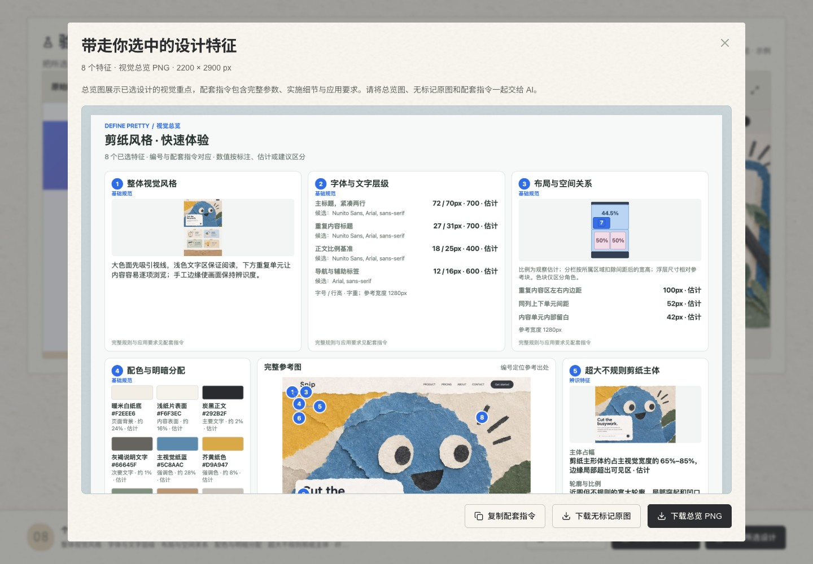](docs/images/guide/04-export.jpg)

## 常见问题

**可以直接上传现有网站吗？**

目前工作台内可选择内置网页、自定义生成网页和历史网页，暂不支持上传网站项目。要用到自己的代码库，导出图片与配套指令后，在项目中交给 AI 执行即可。

**在哪里选择模型？**

页头「生成设置」用于特征提炼与 AI 补全；网页验证区域的「测试模型」用于网页生成、验证和继续优化。可选模型由本机 Codex CLI 提供。

**关闭后记录还在吗？**

参考图、卡片和任务历史保存在本机，重新启动后可以继续查看。内置使用指引是临时演示，不会写入你的工作区。真实 AI 任务需要联网，并使用你所配置服务的账号与额度。

**启动或生成遇到问题怎么办？**

先确认 Node.js 版本，以及 Codex CLI 是否安装并登录。也可以运行环境检查：

```sh
npx --yes --package ./define-pretty.tgz define-pretty --doctor
```

安装或更新 Codex、修改登录后，请重启工作台。当前发布检查覆盖 macOS 和 Linux，Windows 尚未完成同等验证。

---

欢迎通过 [Issues](https://github.com/SpaceCoder-Kafka/define-pretty/issues) 分享使用反馈和效果示例。源码运行、配置与打包说明见 [开发与发布说明](docs/development.md)。
